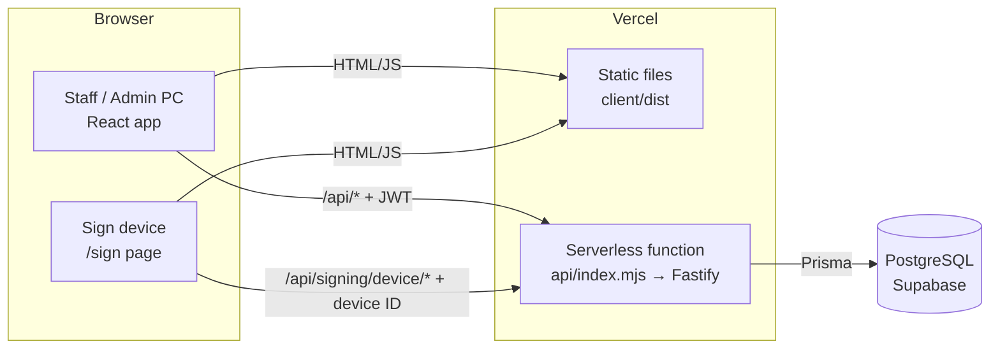
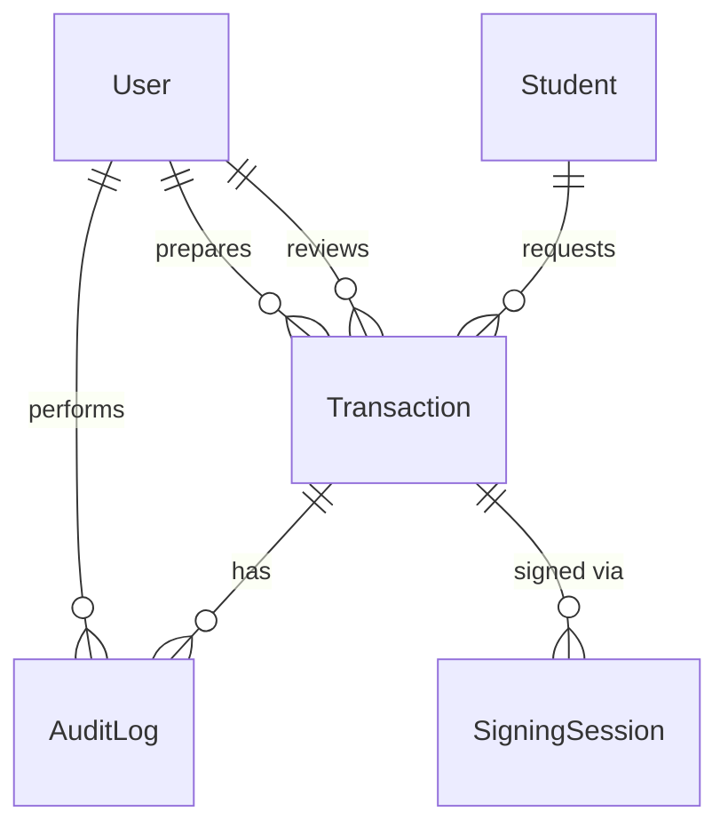
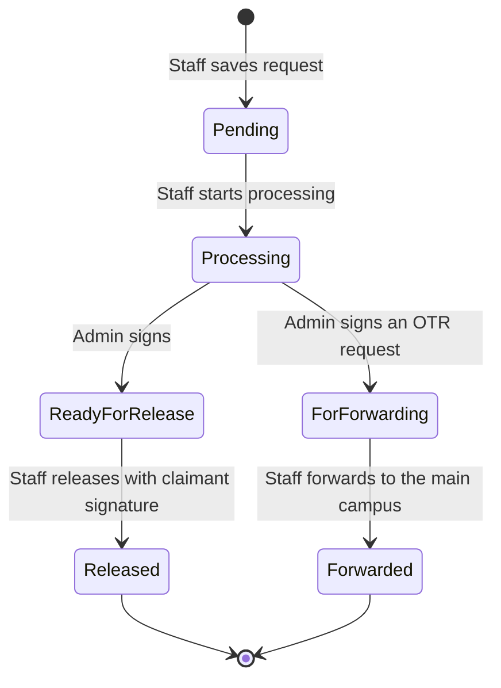
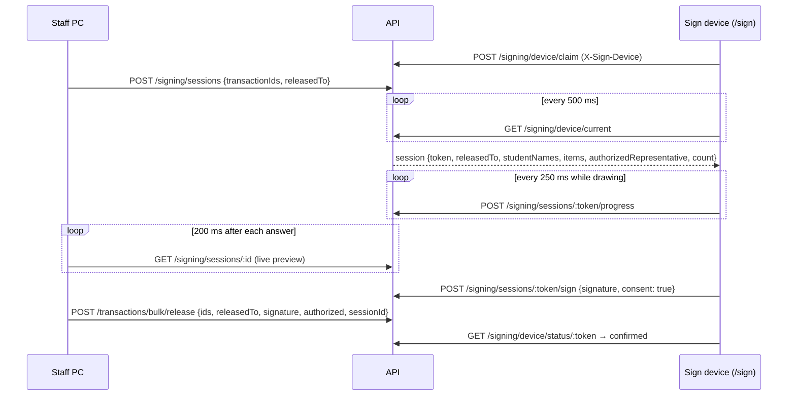

# RTAMS — Technical Design Document

**System:** Registrar Task Accomplishment Monitoring System (RTAMS), Bicol University Polangui
**Version:** 2.0 (covers the changes requested in [v2.md](v2.md))
**Last updated:** October 28, 2026 (OTR forwarding, authorization letters, YYYY-MM-DD dates; see [changes.md](changes.md))

This document explains how RTAMS is built. It covers the architecture, the data model, the transaction workflow, the signing mechanism, report generation and security. It is written for developers maintaining the system and for reviewers who need to understand the design decisions. For what the system does from a user's point of view, see [USER ROLES.md](USER%20ROLES.md). For setup, see [LOCAL_SETUP_GUIDE.md](LOCAL_SETUP_GUIDE.md) and [VERCEL_DEPLOYMENT_GUIDE.md](VERCEL_DEPLOYMENT_GUIDE.md).

---

## 1. Overview

The Registrar's Office records every document request: who asked for which documents, who prepared them, when the Registrar signed them, and who claimed them. RTAMS replaces the paper logbooks with a web application. It has three kinds of users:

| User | Device | What they do |
|---|---|---|
| Staff | Office PC | Encode requests, start processing, release documents, forward OTRs |
| Admin (Registrar) | Office PC | Sign documents, view reports, manage staff and students |
| Claimant | Sign device (no login) | Signs to acknowledge receipt; may be an authorized representative |

The two official logbooks the office submits, the **ARTA Logbook** and the **BUP Logbook**, are generated directly from the recorded transactions as Excel files.

## 2. Architecture



The code is an npm workspace in `rtms/` with three packages:

| Package | Purpose | Main technologies |
|---|---|---|
| `shared` (`@rtams/shared`) | Types, Zod validation schemas and constants used by both sides (document types, program aliases, date and duration helpers) | TypeScript, Zod |
| `server` (`@rtams/server`) | REST API and business logic | Fastify 4, Prisma 6, PostgreSQL, JWT, bcrypt, ExcelJS |
| `client` (`@rtams/client`) | Single-page app for staff, admin and the sign device | React 19, Vite, Tailwind CSS, Radix UI, react-signature-canvas |

**Deployment.** On Vercel, the client is served as static files and all `/api/*` requests are rewritten to one serverless function (`rtms/api/index.mjs`). That function builds the Fastify app once per warm instance and forwards each request with `fastify.inject()`. The response body is passed back as raw bytes (`rawPayload`) so binary downloads such as the Excel logbooks are not corrupted.

Because the server runs as short-lived serverless instances, **no state is kept in memory between requests**. Anything that must be shared, such as signing sessions, the sign device lock and staff activity, lives in the database. The one exception is a 10-second per-instance cache of the "is any staff active" check, which is safe to lose.

### 2.1 Server layout

```
server/src/
├── app.ts                 # buildApp(): registers plugins and routes
├── index.ts               # Local entry point (app.listen)
├── config/                # env.ts, db.ts (Prisma singleton)
├── middleware/            # authenticate (JWT), requireAdmin / requireStaff
├── routes/                # HTTP layer: validation and responses
│   ├── auth.routes.ts         # login, logout, heartbeat
│   ├── transaction.routes.ts  # single and bulk status changes
│   ├── signing.routes.ts      # signing sessions and device lock
│   ├── student.routes.ts      # search, directory, create, import
│   ├── report.routes.ts       # JSON preview and xlsx exports
│   ├── audit.routes.ts
│   └── user.routes.ts
├── services/              # Business logic
│   ├── transaction.service.ts # status transitions
│   ├── report.service.ts      # ARTA/BUP row building
│   ├── audit.service.ts
│   └── auth.service.ts
└── utils/                 # jwt, password, doc-mapper, logbook-xlsx
```

### 2.2 Client layout

```
client/src/
├── App.tsx                # Routes: /login, /sign, /staff, /admin/*
├── components/
│   ├── layout/AppLayout.tsx          # Top bar, menu drawer, timeout, heartbeat
│   ├── transactions/                 # TransactionTable, dialogs, ResetSignDeviceButton
│   ├── students/                     # Autocomplete, AddStudentDialog, BulkImportDialog
│   └── ui/                           # Button, Dialog, TopScrollContainer, ...
├── pages/                 # One component per screen
├── hooks/                 # useInactivityTimeout, useActivityHeartbeat, useStudentSearch
└── lib/                   # api (axios), auth context, date and format helpers
```

## 3. Data model



| Table | Key fields | Notes |
|---|---|---|
| `User` | `name`, `username`, `passwordHash`, `role` (`admin`/`staff`), `status`, `lastActiveAt` | `lastActiveAt` is the staff-activity signal used by the sign device. |
| `Student` | `studentNumber` (unique), names, `email` (BU email), `sex` (`M`/`F`), `contactNumber`, `course`, `yearLevel`, `active`, `isAlumni` | Alumni use `yearLevel = 0`. Not-enrolled students (`active = false`) are reported with year level `-1` (`NOT_ENROLLED_YEAR_LEVEL`). Manually added records without a student number get `MANUAL-<id>`. |
| `Transaction` | `studentId`, snapshot fields (`studentName`, `studentCourse`, `studentYearLevel`), `docCOR`, `docCOG`, `docGMC`, `docAUTH`, `docOTR`, `others`, `othersCount`, `status`, prepared/reviewed/released fields, `releasedByAuthorization`, `duration`, `signature` | Student details are copied at creation so later roster changes don't rewrite history. `signature` is a PNG data URL. `releasedByAuthorization` is true when someone other than the requestor claimed with an authorization letter. For a forwarded OTR, `releasedTo` is "Main Campus" and `releasedAt` is the forward time. |
| `AuditLog` | `transactionId`, `action`, `previousStatus`, `newStatus`, `performedBy`, `performedByName`, `timestamp` | One row per status change. |
| `SigningSession` | `transactionId`, `transactionIds[]`, `token`, `releasedTo`, `liveSignature`, `status`, `consentAt`, `completedAt` | One session can cover several transactions for one claimant. |
| `SignDeviceLock` | `id` (always `"sign-device"`), `deviceId`, `lastSeenAt` | Single row naming the one device allowed to sign. |

Document counts are stored as one integer column per type rather than JSON, which keeps the logbook totals simple to compute. The API exposes them as a `requestedDocuments` object (`{ COR, COG, GMC, AUTH, OTR }`); `utils/doc-mapper.ts` converts between the two shapes.

`DOCUMENT_TYPES` (the request form's counters) is `COR, COG, GMC, AUTH`. OTR is no longer a counter: it is typed under Others, and `docOTR` is kept only so older requests still display. `REQUESTED_DOCUMENT_KEYS` adds OTR back for display, and `formatRequestedDocuments()` in `shared/constants.ts` builds the one-line summary ("COR (2), COG, LOA") used by the ARTA logbook, the release dialog and the sign page.

**Request rules** (enforced in `createTransaction()`, mirrored on the form):
- GMC is only for undergraduates: it is rejected, and hidden on the form, for an alumni requester.
- `isOtrRequest(others)` matches "OTR" or "Transcript of Records". An OTR request cannot also carry COR, COG, GMC or AUTH counts, because it is forwarded rather than released.

**Migrations** live in `server/prisma/migrations/`. The v2 migration (`20260917000000_v2_updates`) renames `docCMC` to `docGMC` with `RENAME COLUMN`, so existing counts are kept. It also adds the new student, user and signing columns and creates `SignDeviceLock`. `20261028000000_release_authorization` adds `Transaction.releasedByAuthorization` (default `false`). The new statuses need no migration, since `status` is a plain string.

## 4. Transaction workflow



OTRs are released at the main campus, so this office only does the initial processing. `bulkSign()` picks the target per transaction: `isOtrRequest(t.others)` goes to **For Forwarding**, everything else to **Ready for Release**. A forwarded request never gets a claimant signature, and the signing session endpoint only accepts Ready for Release, so it cannot reach the sign device.

All transitions go through one function, `transition()` in `transaction.service.ts`. It:

1. Loads every requested transaction inside a database transaction.
2. Rejects the whole request if any id is missing or not in the expected status, naming the affected students.
3. Updates each transaction and writes one audit row per transaction.

The target status can be a fixed string or a function of the transaction, which is how signing routes OTRs to For Forwarding.

The single-item actions (`startProcessing`, `signTransaction`, `releaseTransaction`) call the bulk versions with one id, so both paths share the same rules. Signing also records the reviewer and computes `duration` (signed time minus prepared time).

| Action | Endpoint | Role | Change |
|---|---|---|---|
| Create | `POST /api/transactions` | any logged-in user | → Pending |
| Start processing | `POST /api/transactions/bulk/start` | staff | Pending → Processing |
| Sign | `POST /api/transactions/bulk/sign` | admin | Processing → Ready for Release |
| Release | `POST /api/transactions/bulk/release` | staff | Ready for Release → Released |
| Forward | `POST /api/transactions/bulk/forward` | staff | For Forwarding → Forwarded (`releasedTo = "Main Campus"`, `releasedAt = now`) |

The older single-item `PATCH /api/transactions/:id/{start,sign,release}` routes still work.

### Authorization letters

`bulkRelease()` takes an `authorized` flag. Before releasing, it loads the students' names and checks the claimant with `isRequestorName()` (`shared/types/student.ts`). That check ignores word order, commas, periods and case, so "Juan Dela Cruz" matches "Dela Cruz, Juan", and a single letter matches an initial. The claimant needs at least two words.

- If the claimant is one of the requestors, the release goes ahead and `releasedByAuthorization` stays false.
- Otherwise the release is refused with a 400 unless `authorized: true` is sent, and `releasedByAuthorization` is set to true.

The Release dialog runs the same check as the name is typed. It shows a warning and a required **Authorization letter received and verified** checkbox, and keeps Send to Sign Device and Confirm Release disabled until it is ticked. The table shows "Authorized Rep." under Released To, and the BUP logbook appends "(Authorized Rep.)".

### 4.1 Bulk actions in the UI

`TransactionTable` shows a checkbox on each row and a "select all" box. Selection is kept inside the table as a map from transaction id to the status it had when selected. When the dashboard refreshes (every 5 seconds), any row that disappeared or changed status is dropped from the selection, so the selection clears itself after a successful bulk action.

The bulk bar only offers actions that apply to the selected rows, and each action receives only the eligible rows. For example, "Start Processing (3)" sends only the Pending rows even if Released rows are also selected.

### 4.2 Dashboard periods

Both dashboards show a period that defaults to today:

- Staff choose Today, Yesterday or a date range.
- Admin picks a From and a To date, both starting at today.

The table and the four stat cards use the same `startDate`/`endDate`, answered by one request with `includeCounts=1`. Either bound may be omitted, which `phDayRange()` turns into an open-ended range; sending neither returns every date. A period covering more than one day is requested with `limit=200`, and the card header shows `X of Y` when more rows match than were returned.

There is no separate view for unclaimed documents: a range plus `status=Ready for Release` is the backlog. `TransactionTable` marks any request still at Ready for Release or For Forwarding from an earlier day with "Nd waiting". The "Ready for Release / Forwarding" card adds the two statuses, and "Completed" adds Released and Forwarded.

**Date formats.** Dates are shown as `YYYY-MM-DD` (`formatDate()`, `formatDateTime()` in `client/src/lib/utils.ts`; `en-CA` formatting in `report.service.ts` for the logbooks). The one exception is `formatPeriod()` in `client/src/lib/date.ts`, the dashboard greeting line, which spells the day out ("Wednesday, October 28, 2026"). Year levels read "1st Year" to "4th Year" (`formatYearOrdinal()`) in filters and forms; tables keep the short `BSIT-1`.

**Time zone.** Dates are Philippine calendar days (UTC+8) regardless of where the server runs. `phDayRange()` in `shared/constants.ts` converts `YYYY-MM-DD` into `[day 00:00 +08:00, next day 00:00 +08:00)`. Transaction lists, the audit log and reports all use it. On the client, `lib/date.ts` computes "today" with the `Asia/Manila` time zone.

## 5. Signing on the sign device

A claimant signs on a separate sign device that has no login of its own; it is gated by the device lock and a live staff session instead (see 5.1). Staff start the signing from the Release dialog, and the sign device picks it up by polling.



**Session rules**

- Only one session can be open (`pending` or `signed`) at a time.
- A pending session expires after 10 minutes.
- Staff can cancel a session until they confirm it. The Release dialog resets as soon as Cancel Signing is clicked and sends the `DELETE` in the background; if that fails it tells staff to use Reset Sign Device.
- The dialog polls the session again 200 ms after each answer rather than on a fixed 200 ms timer. On Vercel a check can take longer than 200 ms, and a fixed timer piled up overlapping checks that delayed Cancel Signing.
- One session can cover up to 200 Ready-for-Release transactions for the same claimant, which is how one block representative claims for the whole block. The signature is saved to all of them.

**What the claimant sees.** `device/current` returns `items` (each student with `formatRequestedDocuments()`) and `authorizedRepresentative` (from `isRequestorName()`). The sign page shows "Authorized Representative" under the claimant's name when it applies. One request is listed inline as "Documents to claim:"; two or more open in a dialog from a **View documents to claim (n)** button, or from the "Claiming n documents · View" line on the signing screen. The staff Release dialog uses the same pattern.

**Data Privacy consent.** The sign page first shows a Data Privacy notice that refers to the Data Privacy Act of 2012 (RA 10173). The signature pad appears only after the claimant taps **I Agree**, and consent resets for every session. In landscape the notice screen uses two columns (claimant on the left, notice and I Agree on the right) so a sideways phone needs no scrolling. The server also rejects a signature unless the request includes `consent: true`, and it stores the time in `SigningSession.consentAt`.

**Transparent signatures.** The signature pad has no background fill, so `toDataURL()` produces a PNG with a transparent background. This is what lets the BUP logbook show the signature like an e-signature. Do not add a `backgroundColor` to `SignaturePad`.

### 5.1 Two conditions, both enforced on the server

The sign device has **no login of its own**. Every sign device endpoint (`device/current`, `sessions/:token/progress`, `sessions/:token/sign`, `device/status/:token`) runs the `requireSignDevice` guard, which checks both conditions in order:

1. **Device lock** — the request carries the `X-Sign-Device` header of the device holding the `SignDeviceLock` row, otherwise `423 not_claimed`.
2. **Live staff session** — `isStaffActive()`, otherwise `503 no_active_staff`.

The lock itself: the sign device page creates a random device ID on first open and keeps it in `localStorage`. `POST /api/signing/device/claim` grants the lock when no device holds it, when this device already holds it, or when the holder hasn't been seen for 60 s (`LOCK_STALE_MS`); otherwise `423 locked`. The claim uses a conditional `updateMany` followed by `createMany({ skipDuplicates: true })`, so two devices claiming at the same moment cannot both win. The guard refreshes `lastSeenAt` at most every 10 s. Staff or admin can free it with **Reset Sign Device** (`DELETE /api/signing/device/lock`, login required).

Because the lock goes to whichever device claims it first, someone who opens the page before the real one can take it; Reset Sign Device is the recovery.

### 5.2 Only while a Staff member is working

`isStaffActive()` counts users with `role: 'staff'`, `status: 'active'` and a `lastActiveAt` within 3 minutes (`STAFF_ACTIVE_MS`), cached for 10 s. **Admin sessions do not count**, since an admin cannot release documents.

`lastActiveAt` comes from the staff member's own requests, not a heartbeat: `authenticate` calls `touchActivity()` (in `services/auth.service.ts`) after verifying a token, writing at most once a minute per user. An open dashboard polls `/api/transactions` every 5 s and the Release dialog polls the session every 200 ms, so a staff member who is logged in stays marked active, including while they stand back and watch the claimant sign. Logging in sets the marker; `POST /api/auth/logout` clears it, so the sign device goes inactive within the 10-second cache window.

The sign device shows "Device Already in Use" for `423` and "Signature Pad Inactive — Staff login required" for `503`, retrying every 3 seconds until both conditions hold again.

### 5.3 Abandoned sessions

A session that a claimant signed but nobody confirmed expires like a pending one, after `SESSION_TIMEOUT_MS`, so it cannot block signing for good. Its signature is already saved on the transactions. Confirming more than 10 minutes after the claimant signs therefore needs a fresh signature.

## 6. Students

- **Search** (`GET /api/students?q=`) returns up to 10 students for the request form's autocomplete: enrolled students and alumni first, then not-enrolled students.
- **Directory** (`GET /api/students/directory`, admin only) returns active, non-alumni students with pagination (50 per page) and a `total`. It can be filtered by program alias (e.g. `course=BSIT`) and by a search term. This backs the "Enrolled Students" page.
- **Import** (`POST /api/students/bulk`) treats the uploaded file as the complete current roster, inside one database transaction:
  - students in the file are created or updated (and reactivated if needed);
  - non-alumni students missing from the file are marked inactive;
  - nothing is deleted.
  - Optional columns `Sex` (M/F, Male/Female) and `Contact Number` are accepted.
- **Programs** are stored by full name. `COURSE_ALIASES` in `shared/constants.ts` maps the short forms (BSIT, BSCS, …). `abbreviateCourse()` and `formatCourseYear()` produce the short labels shown in tables and the logbook (e.g. `BSIT-1`, `BSIT-Alumni`, `BSIT-Not Enrolled`).
- **Alumni.** Staff add alumni with the **Alumni** button on the request form. The record is saved with `isAlumni = true` and `yearLevel = 0` and selected immediately.
- **Not enrolled.** A student missing from the current roster (`active = false`, not alumni) is not enrolled.
  - `currentYearLevel()` in `shared/types/student.ts` reports such a student with year level `-1`, shown as "Not Enrolled". The API and new transactions use it, and the stored year level is kept.
  - Staff add not-enrolled students who were never imported with the **Add Student** button on the request form. The record is saved with `active = false` and `yearLevel = -1` and selected immediately.
  - If the student later appears in a roster import under the same student number, they are reactivated with their real year level. Earlier transactions keep "Not Enrolled".

## 7. Reports

`GET /api/reports?startDate&endDate&format=json|arta|bup` (admin only) reads **Released** and **Forwarded** transactions whose release (or forward) date falls in the range (Philippine time), oldest first, together with the student's email, contact number and sex.

| Format | Output | Columns |
|---|---|---|
| `json` | On-screen preview | Same as ARTA |
| `arta` | `ARTA-Logbook-<start>-to-<end>.xlsx` | #, External Client Name, Service Availed, Client Contact, Client Contact Info (Email Address), Day of Service Completion (release date). No signature column. |
| `bup` | `BUP-Logbook-<start>-to-<end>.xlsx` | No., Date, Name, Sex, Course & Year Level, Requested Documents/Services (COR, COG, GMC, AUTH, OTHERS), Received/Prepared By, Reviewed/Signed By, Duration of Process, Released To/Claimed By, Signature |

All logbook dates are `YYYY-MM-DD`.

The workbooks are built by `utils/logbook-xlsx.ts` with ExcelJS:

- **Header band (BUP).** Row 1 is merged across all columns and reads "COLLEGE/CAMPUS: BICOL UNIVERSITY POLANGUI" in white on an orange fill (`#F79646`); the column headers follow on rows 4–5.
- **Header band (ARTA).** Rows 1 and 3 are merged across all columns for the office name and the completion note, with the column headers on row 5.
- **Two-row header (BUP).** The first header row groups the five document columns under "Requested Documents/Services". The other headers span both rows.
- **Name columns (BUP).** The three "By" cells hold the name with the date and time on a second line. Released To/Claimed By appends "(Authorized Rep.)" when `releasedByAuthorization` is set.
- **OTHERS (BUP).** The OTHERS cell lists each service with its count, e.g. "OTR - 1". Older requests' `docOTR` counts are folded in as "OTR - n". The TOTAL row lists each service with its total across the period.
- **Signatures (BUP only).** Each claimant's PNG signature is placed as an image in the Signature column; those rows are given a height of 42 so the image fits. Forwarded OTRs have none.
- **Totals (BUP).** A final **TOTAL** row sums each document column.

## 8. Security

| Concern | Measure |
|---|---|
| Passwords | bcrypt hashes |
| Sessions | JWT signed with `JWT_SECRET`, expires after 30 minutes; the client also logs out after 30 minutes without input. Production refuses to start with a weak or default secret. |
| Authorization | `authenticate` on all non-public routes; `requireAdmin` / `requireStaff` per route (e.g. only admin can sign, only staff can release or forward) |
| Claims by others | A release to someone other than the requestor is refused unless staff confirm an authorization letter, and the release is recorded as such |
| Input validation | Zod schemas from `@rtams/shared` on every write |
| Brute force | Login is rate-limited to 10 requests per minute per IP when running as a normal server. This limit is in memory, so it does not apply on Vercel. |
| CORS | Only origins listed in `CORS_ORIGIN` |
| Sign device endpoints | No login, but limited to the device holding the lock and to times when staff are active; session tokens are 32 random bytes |
| Personal data | Consent is required and timestamped before a signature is stored |
| Audit | Every status change records who did it and when |

## 9. API reference

| Method | Endpoint | Access |
|---|---|---|
| POST | `/api/auth/login` | public (rate-limited) |
| POST | `/api/auth/logout` | public |
| GET | `/api/transactions` (`status`, `startDate`, `endDate`, `search`, `course`, `yearLevel`, `includeCounts`, `page`, `limit`) | logged in |
| GET | `/api/transactions/:id` | logged in |
| POST | `/api/transactions` | logged in |
| POST | `/api/transactions/bulk/start` | staff |
| POST | `/api/transactions/bulk/sign` | admin |
| POST | `/api/transactions/bulk/release` | staff |
| PATCH | `/api/transactions/:id/start` · `/sign` · `/release` | staff · admin · staff |
| GET | `/api/students?q=` | logged in |
| GET | `/api/students/directory` (`q`, `course`, `page`, `limit`) | admin |
| POST | `/api/students` | logged in |
| POST | `/api/students/bulk` | logged in |
| DELETE | `/api/students/:id` | admin (only students without transactions) |
| GET | `/api/reports` (`startDate`, `endDate`, `format`) | admin |
| GET | `/api/audit-logs` (`startDate`, `endDate`, `page`, `limit`) | admin |
| GET · POST · PATCH | `/api/users`, `/api/users/:id`, `/api/users/:id/reset-password` | admin |
| POST | `/api/signing/sessions` | staff |
| GET · DELETE | `/api/signing/sessions/:id` | staff |
| POST | `/api/signing/device/claim` | sign device (device ID header) |
| DELETE | `/api/signing/device/lock` | logged in |
| GET | `/api/signing/device/current` | registered sign device, active staff |
| POST | `/api/signing/sessions/:token/progress` · `/sign` | registered sign device, active staff |
| GET | `/api/signing/device/status/:token` | registered sign device, active staff |

## 10. Configuration

| Variable | Purpose |
|---|---|
| `DATABASE_URL` | Pooled connection string (add `pgbouncer=true` for the Supabase pooler) |
| `DIRECT_URL` | Direct connection used by Prisma migrations |
| `JWT_SECRET` | Token signing secret (32+ characters in production) |
| `PORT` | Local server port (default 3001) |
| `CORS_ORIGIN` | Comma-separated allowed origins |
| `NODE_ENV` | `production` enables the secret check |

The timing values are constants in `signing.routes.ts`:

| Constant | Value | Meaning |
|---|---|---|
| `SESSION_TIMEOUT_MS` | 10 min | Session lifetime, pending or signed-but-unconfirmed |
| `LOCK_STALE_MS` | 60 s | How long before another device can take over the sign device |
| `LOCK_TOUCH_MS` | 10 s | Throttle on lock heartbeat writes |
| `STAFF_ACTIVE_MS` | 3 min | How recent a staff member's last request must be |
| `STAFF_CHECK_CACHE_MS` | 10 s | Cache on the staff-active lookup |

## 11. Verification

There is no automated test suite yet. The v2 changes were checked as follows:

- `npm run build` type-checks and builds all three packages.
- All migrations were applied to an empty PostgreSQL-compatible database. `prisma migrate diff` against `schema.prisma` reported no differences.
- An end-to-end API script ran 34 checks through `fastify.inject()`:
  - sign device lock and staff-activity rules;
  - consent enforcement;
  - student and alumni creation;
  - roster import that leaves alumni active;
  - directory filters;
  - bulk start, sign and release with role checks;
  - audit counts;
  - both xlsx downloads.
- Generated ARTA and BUP files were inspected for merged headers, the orange fill, embedded images and correct totals.

**Recommended manual checks after deployment**

- Open `/sign` on two devices.
- Release a block of requests to one claimant.
- Download both logbooks from the deployed site and open them in Excel.

## 12. Known limitations and future work

- **Polling.** The staff release dialog polls every 200 ms and the sign device every 250–500 ms. That is simple and works on serverless, but it produces many small requests. Server-sent events or Supabase Realtime would reduce the load.
- **No login rate limit on Vercel.** The login limit only applies when the API runs as a normal server. A shared store such as Redis would be needed to enforce it on Vercel.
- **One sign device.** The lock is a single row. Supporting several counters would mean one lock row per counter, with sessions assigned to a counter.
- **Page size.** The dashboards load up to 50 transactions for the selected day. Busier days would need pagination in the table.
- **No automated tests.** The verification script used for v2 could be turned into a permanent integration test suite.
